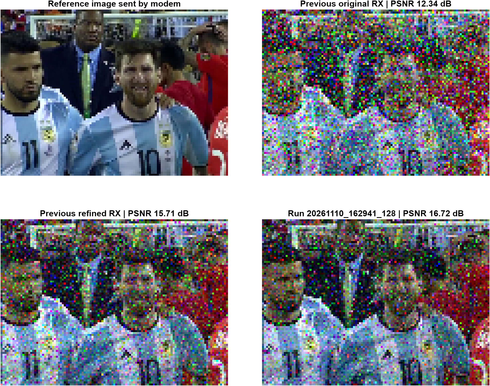

# CH30 — Truyền ảnh bằng OFDM qua âm thanh cận siêu âm

Thực hiện thí nghiệm truyền ảnh từ loa điện thoại đến microphone máy tính, sử dụng OFDM với tần số sóng mang **18,2 kHz**.

## Ảnh gốc


## Kết quả tốt nhất hiện có

Lần chạy **`20261110_162941_128`**, lưu lúc **16:29:47 ngày 10/11/2026 (UTC+7)**, cho kết quả tốt nhất trong **ba kết quả đã đối chiếu**. C

| Kết quả | PSNR ↑ (dB) | MAE ↓ (0–255) | Preamble score | Lệch tần số (Hz) |
| --- | ---: | ---: | ---: | ---: |
| Bản thu trước — baseline | 12,339 | 41,092 | 0,640 | −0,272660 |
| Bản thu trước — sau hiệu chỉnh (xóa 2 giây đầu nhiễu) | 15,709 | 27,956 | 0,880 | −0,306037 |
| **Lần chạy tốt nhất** | **16,716** | **23,571** | **0,880** | **−0,109064** |



- [Lần giải mã có kết quả tốt nhất](results/best/results/recovered_image.png).
- [Các biểu đồ của lần thu tốt nhất](results/best/figures/Figure_01_receiver_diagnostics.png).
- [Các thông số của lần chạy tốt nhất](results/best/manifest.json)
- [Số liệu so sánh đầy đủ](results/comparison/comparison.json), gồm RMSE và các thông số bản ghi âm.

Ảnh vẫn còn nhiễu. PSNR/MAE được tính so với ảnh đầu vào modem sau giảm mẫu và chuẩn hóa từng kênh màu theo bộ phát, không so trực tiếp với JPEG kích thước gốc. Bộ tham số phát của các kết quả đã đối chiếu trùng nhau.

## Cấu trúc thư mục

```text
CH30/
├── matlab/                     # Mã đang sử dụng
│   ├── NUS_AOFDM_TX.m           # Tạo tín hiệu phát WAV và tham số đi kèm
│   ├── NUS_AOFDM_DEM.m          # Thu microphone và giải điều chế
│   ├── NUS_AOFDM_refine_recording.m
│   ├── NUS_AOFDM_save_results.m
│   └── compare_results.m       # Tính lại bảng và hình so sánh
├── data/
│   ├── input/myphoto.jpg       # Ảnh đầu vào
│   ├── tx/                     # WAV, tham số và mẫu TX của bộ dữ liệu có sẵn
│   └── recordings/             # Bản ghi âm trước dùng cho baseline/refined
├── results/
│   ├── best/                   # Snapshot đầy đủ của lần chạy tốt nhất
│   │   ├── code/               # Bản mã gốc tại thời điểm lưu
│   │   ├── config/             # Ảnh, WAV, mẫu TX và tham số của lần chạy
│   │   ├── figures/            # Hình chẩn đoán và hình khôi phục
│   │   ├── recording/          # Dữ liệu microphone
│   │   ├── results/            # Ảnh khôi phục và workspace giải mã
│   │   ├── manifest.json
│   │   └── selection.json
│   ├── previous/               # Kết quả baseline/refined trước đó
│   └── comparison/             # Bảng số liệu JSON/Markdown và ảnh so sánh
├── docs/                       # Tài liệu Chapter 30 và hướng dẫn cũ
├── output/                     # Đầu ra mới và các gói ZIP cũ; Git bỏ qua
└── tmp/                        # File tạm và thiết lập máy; Git bỏ qua
```

Các file `.fig` vẫn được giữ trên máy và được Git bỏ qua; bản PNG tương ứng có trong repo. Mã nên chạy nằm ở `matlab/`; `results/best/code/` giữ nguyên bản chụp lịch sử.

## Yêu cầu

- MATLAB; lần thwujc nghiệm trên dùng phiên bản **R2026b Update 1**.
- **Signal Processing Toolbox**

Mở MATLAB tại thư mục gốc repo rồi thêm đường dẫn:

```matlab
addpath(fullfile(pwd, 'matlab'));
```

## Xem và kiểm tra kết quả có sẵn

Xem ảnh tốt nhất, không cần microphone:

```matlab
image(imread(fullfile('results', 'best', 'results', 'recovered_image.png')));
axis image off;
```

Tính lại PSNR, MAE, RMSE, preamble score và hình so sánh từ dữ liệu đã lưu:

```matlab
compare_results;
```

Lệnh này cập nhật các file trong `results/comparison/`, đồng thời kiểm tra ảnh PNG khớp với ảnh trong workspace và đối chiếu tham số TX.

## Thực hiện lần truyền mới

1. **Chuẩn bị tín hiệu phát.** Có thể dùng bộ WAV + tham số có sẵn trong `data/tx/`. Nếu muốn tạo tín hiệu mới từ `data/input/myphoto.jpg`, chạy:

   ```matlab
   NUS_AOFDM_TX;
   ```

   Ba file mới được ghi vào `output/tx/`: `NUS_AOFDM_TX.wav`, `NUS_AOFDM_TX_parameters.mat` và `NUS_AOFDM_TX_tx.mat`. Mỗi lần chạy TX tạo pilot và interleaving ngẫu nhiên, ghi đè bộ file tại đây.

2. **Chọn microphone.** Chạy `audiodevinfo` và sửa biến `preferred_microphone` trong `matlab/NUS_AOFDM_DEM.m` cho đúng thiết bị. Giá trị hiện tại là `Microphone (Realtek(R) Audio)`.

3. **Phát đúng WAV và thu.** Bộ thu ưu tiên bộ WAV + tham số trong `output/tx/` nếu cả hai file tồn tại; nếu không sẽ dùng `data/tx/`. Đường dẫn được in ra trong Command Window. Chuyển đúng WAV đó sang điện thoại, bắt đầu phát ngay trước khi chạy:

   ```matlab
   NUS_AOFDM_DEM;
   ```

   Giữ cố định loa và microphone. WAV lặp hai packet; bộ thu ghi trong thời lượng WAV cộng 3 giây. Ảnh giải mã xuất hiện ở Figure 3.

4. **Lưu ngay phiên thu vừa chạy**, trước khi chạy TX hoặc refine:

   ```matlab
   run_dir = NUS_AOFDM_save_results;
   ```

   Kết quả mới nằm ở `output/runs/<timestamp>/`, gồm mã, cấu hình, bản ghi âm, workspace và các figure đang mở. Hàm lưu trạng thái hiện tại, không thu âm hoặc giải mã lại.

**Luôn giữ WAV, tham số TX và bản ghi âm của cùng một lần truyền cùng nhau.** Không dùng tham số vừa tạo lại để giải mã bản thu cũ. Hai bộ TX có cùng N/GI/fs vẫn có thể khác pilot và hoán vị pixel.

## Xử lý lại bản ghi âm

Chạy refine trên bản thu trước đi kèm repo:

```matlab
[recovered, report] = NUS_AOFDM_refine_recording;
```

Kết quả ghi vào `output/refined/`. Hàm thử bỏ qua các đoạn đầu bản thu và chọn ứng viên có preamble score lớn nhất; kết quả có sẵn của bản thu trước chọn bỏ **2 giây**. Tiêu chí này không bảo đảm PSNR cao nhất.

Để xử lý bản ghi khác, truyền đúng file tham số và thư mục đầu ra:

```matlab
[recovered, report] = NUS_AOFDM_refine_recording( ...
    fullfile('results', 'best', 'recording', 'NUS_AOFDM_RX_debug.mat'), ...
    fullfile('results', 'best', 'config', 'session_TX_parameters.mat'), ...
    fullfile('output', 'refined_best'));
```

Đây là xử lý lại bản ghi; ảnh tốt nhất công bố ở trên là ảnh của phiên thu đã lưu, không phải mặc định đầu ra của lệnh refine này.

## Cấu hình của bộ dữ liệu hiện tại

| Thông số | Giá trị |
| --- | ---: |
| Tần số lấy mẫu `fs` | 44.100 Hz |
| Tần số sóng mang `fc` | 18.200 Hz |
| Số sóng mang `N` | 64 |
| Số mẫu OFDM trước GI `Np` | 1.024 |
| Guard interval `GI` | 128 mẫu |
| Số symbol/frame `Ns` | 5 |
| Số frame `Nf` | 58 |
| Ảnh sau giảm mẫu | 84 × 115 × 3 |
| Thời gian một packet | 7,575510 s |
| Thời lượng WAV lặp hai packet, gồm đuôi lọc | 15,152177 s |
| Thời lượng bản ghi âm | 18,152177 s |

#
## 
